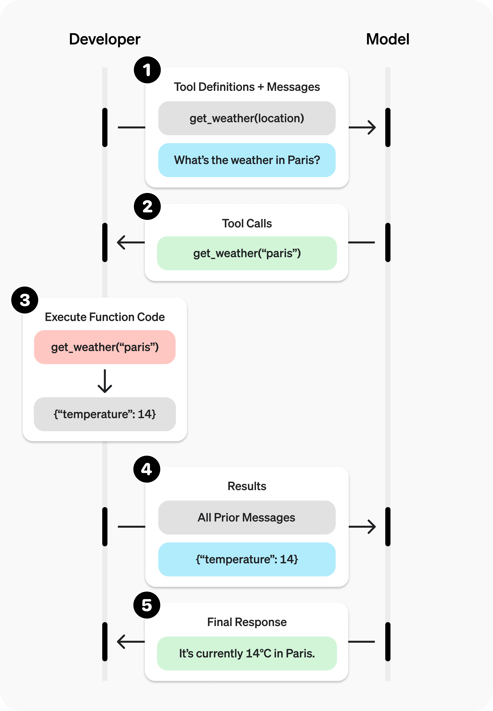

# AGENT 知识点

## Function Call(函数/工具调用)

**函数**或**工具**泛指您告知模型可以使用的某项功能。模型根据提示词生成响应时，可能会判断自己需要工具提供的数据或功能才能执行提示词中的指令。

可以向模型提供能执行以下操作的工具：

- 查询某个地点今天的天气

- 根据用户 ID 查询账户详情

- 为丢失的订单办理退款

**函数调用**或**工具调用**是模型返回的一种特殊响应。模型分析提示词后，如果判断需要调用您提供的某个工具才能执行其中的指令，就可能返回这种响应

如果模型在 API 请求中收到“巴黎的天气怎么样？”这样的提示词，它可能会请求调用 get_weather 工具，并将 Paris 作为 location 参数的值。

**函数调用输出**或**工具调用输出**是工具根据模型调用时提供的输入生成的响应。工具调用输出可以是结构化 JSON 或纯文本，并且应指明它对应模型的哪一次工具调用（后面的示例使用 call_id 标识调用）。 以查询天气为例，完整过程如下：

- 模型可以使用 get_weather 工具，该工具接受 location 参数。
- 收到“巴黎的天气怎么样？”这样的提示词后，模型返回一次工具调用，其中 location 参数的值为 Paris。
- 工具调用输出可以是 JSON 对象（例如，{"temperature": "25", "unit": "C"} 表示当前气温为 25 摄氏度）、图像内容或文件内容。

然后，将工具定义、原始提示词、模型的工具调用和工具调用输出一起发回给模型，就可以得到如下文本响应：

```
The weather in Paris today is 25C.
```

## 工具调用流程

工具调用是应用通过 LLM API 与模型进行多步交互的过程。整个流程大致分为五步：

1. 向模型发送请求，并提供可调用的工具
2. 接收模型返回的工具调用
3. 使用工具调用提供的输入，在应用端执行代码
4. 将工具输出放入第二次请求中，发送给模型
5. 接收模型的最终响应（或更多工具调用）



参考：[demo.py](agent/demo.py)


## 函数定义

通常在每个 API 请求的 tools 参数中声明函数。使用工具搜索时，应用也可以在交互过程中按需加载先前推迟加载的函数。无论采用哪种方式，每个可调用函数的模式结构都相同。函数定义包含以下属性：

字段|说明
--|--
type|应始终为 function
name|函数名称（例如 get_weather）
description|详细说明何时以及如何使用函数
parameters|定义函数输入参数的 JSON 模式
strict|是否对函数调用强制使用严格模式

下面是 get_weather 函数的定义示例：

```json
{
  "type": "function",
  "name": "get_weather",
  "description": "Retrieves current weather for the given location.",
  "parameters": {
    "type": "object",
    "properties": {
      "location": {
        "type": "string",
        "description": "City and country e.g. Bogotá, Colombia"
      },
      "units": {
        "type": "string",
        "enum": ["celsius", "fahrenheit"],
        "description": "Units the temperature will be returned in."
      }
    },
    "required": ["location", "units"],
    "additionalProperties": false
  },
  "strict": true
}
```

由于 parameters 由 JSON 模式定义，可以使用属性类型、枚举、描述、嵌套对象和递归对象等多种特性。


## 定义命名空间

使用命名空间可以按业务领域对相关工具进行分组，例如 crm、billing 或 shipping。命名空间便于组织相似的工具。当模型需要在服务于不同系统或用途的工具之间做选择时，命名空间尤其有用，例如一个搜索工具用于 CRM，另一个用于支持工单系统。

```json
{
  "type": "namespace",
  "name": "crm",
  "description": "CRM tools for customer lookup and order management.",
  "tools": [
    {
      "type": "function",
      "name": "get_customer_profile",
      "description": "Fetch a customer profile by customer ID.",
      "parameters": {
        "type": "object",
        "properties": {
          "customer_id": { "type": "string" }
        },
        "required": ["customer_id"],
        "additionalProperties": false
      }
    },
    {
      "type": "function",
      "name": "list_open_orders",
      "description": "List open orders for a customer ID.",
      "defer_loading": true,
      "parameters": {
        "type": "object",
        "properties": {
          "customer_id": { "type": "string" }
        },
        "required": ["customer_id"],
        "additionalProperties": false
      }
    }
  ]
}
```

## 工具搜索
如果需要让模型使用大量工具，可以通过 tool_search 推迟加载部分或全部工具。模型可以使用 tool_search 工具搜索相关工具，将其添加到模型上下文中，再加以使用


## 定义函数的最佳实践

1. **给函数起一个清楚具体的名称，并详细说明参数和用法。**

    - **明确说明函数和每个参数的用途**，注明参数格式，并解释输出的含义。
    - **在系统提示词中说明何时应使用每个函数，以及何时不应使用**。 通常应当明确告诉模型具体要做什么。
    - **提供示例并涵盖边界情况**，尤其是针对反复出现的错误。（注意：添加示例可能会降低推理模型的表现。）
    - **对于推迟加载的工具，请在函数描述中提供详细指引，并保持命名空间描述简洁**。 命名空间帮助模型选择要加载的工具，函数描述则帮助模型正确使用已加载的工具。

2. **遵循软件工程最佳实践。**

    - **让函数易于理解，行为符合预期**。（参见最小惊讶原则）
    - **使用枚举和对象结构来避免无效状态**。例如，toggle_light(on: bool, off: bool) 允许传入无效的参数组合。
    - **请实习生试用**。 只看提供给模型的信息，实习生或其他人能否正确使用这个函数？（如果不能，他们会问哪些问题？请把答案补充到提示词中。）

3. **减轻模型的负担，尽可能用代码处理。**

    - **对于您已经知道的参数值，无需让模型填写**。 例如，如果您已从上一步的菜单中获得 order_id，就不要再设置 order_id 参数。请将 submit_refund() 定义为无参数函数，并在代码中传递 order_id。
    - **合并总是按顺序调用的函数**。 例如，如果 mark_location() 总是在 query_location() 之后调用，就可以把标记逻辑移到查询函数中。

4. **减少初始可用的函数数量，以提高准确率。**

    - **评估调用效果**，比较函数数量不同时的表现。
    - **尽量让每一轮开始时可用的函数少于 20 个**，这个数量仅供参考。
    - **使用工具搜索**推迟加载规模较大或不常用的工具组，无需一开始就提供全部工具。

5. **利用 OpenAI 资源。**

    - **生成并不断改进函数模式**时，可以使用 Playground。
    - **当函数数量很多或任务较复杂时，可以考虑通过微调提高函数调用的准确率。**


## Token 用量

在底层实现中，函数会以模型训练时学过的语法注入系统消息。因此，可调用函数的定义会占用模型的上下文空间，并按输入 Token 计费。如果遇到 Token 数量限制，建议减少预先加载的函数数量，尽可能缩短描述，或使用工具搜索，只在需要时加载之前推迟加载的工具。

如果工具规范中定义了大量函数，也可以通过**微调**减少 Token 用量。

## 处理函数调用

当模型调用函数时，您必须执行函数并返回结果。模型的响应可能不包含调用，也可能包含一次或多次调用，因此最好按可能有多次调用来处理。

响应的 `output` 数组中包含 `type` 值为 `function_call` 的项。每个这样的项都有一个 `call_id`（稍后提交函数结果时使用）、一个 `name` 和经过 `JSON`编码的 `arguments`。


包含多次函数调用的响应示例
```json
[
    {
        "id": "fc_12345xyz",
        "call_id": "call_12345xyz",
        "type": "function_call",
        "name": "get_weather",
        "arguments": "{\"location\":\"Paris, France\"}"
    },
    {
        "id": "fc_67890abc",
        "call_id": "call_67890abc",
        "type": "function_call",
        "name": "get_weather",
        "arguments": "{\"location\":\"Bogotá, Colombia\"}"
    },
    {
        "id": "fc_99999def",
        "call_id": "call_99999def",
        "type": "function_call",
        "name": "send_email",
        "arguments": "{\"to\":\"bob@email.com\",\"body\":\"Hi bob\"}"
    }
]
```

如果使用工具搜索，还可能看到 tool_search_call 和 tool_search_output 项出现在 function_call 之前。函数加载后，按此处所示的方式处理函数调用即可。


```python
input_messages += response.output

for tool_call in response.output:
    if tool_call.type != "function_call":
        continue

    name = tool_call.name
    args = json.loads(tool_call.arguments)

    result = call_function(name, args)
    input_messages.append(
        {
            "type": "function_call_output",
            "call_id": tool_call.call_id,
            "output": json.dumps(result),
        }
    )
```

上例使用一个假设的 call_function 函数将每次调用分派给相应的函数。下面是一种可能的实现：

```python
def call_function(name, args):
    if name == "get_weather":
        return get_weather(**args)
    if name == "send_email":
        return send_email(**args)
    raise ValueError(f"Unknown function: {name}")
```