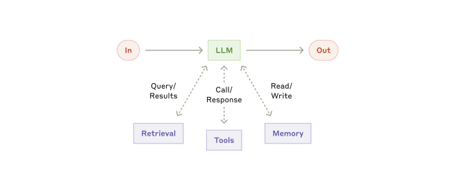
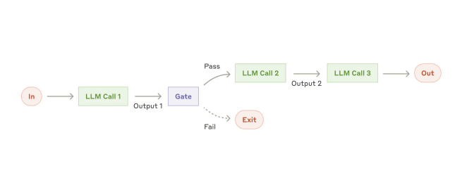
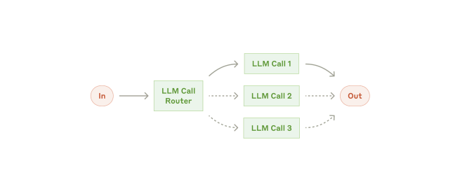
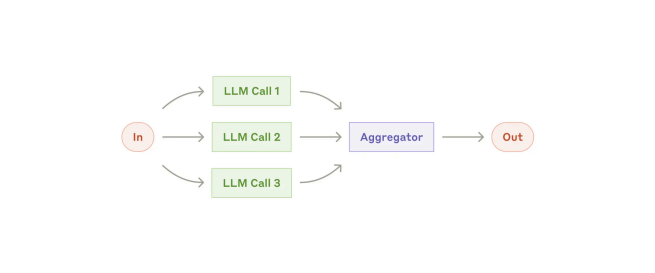
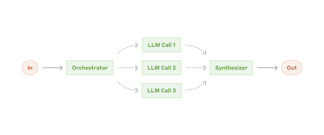
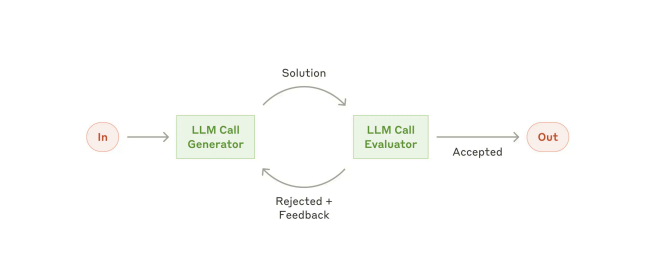
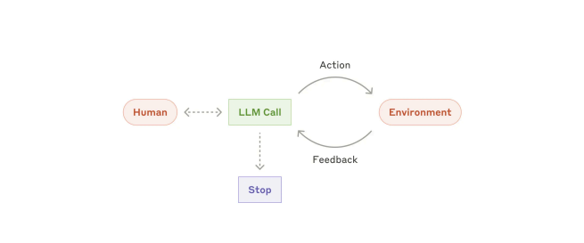
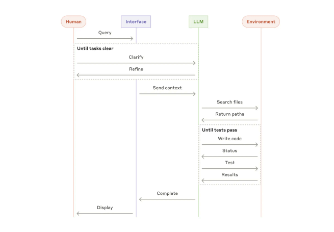

# 构建高效的智能体

**原文**：Building effective agents · Anthropic Engineering · 发布于 2024 年 12 月 19 日
**原文链接**：https://www.anthropic.com/research/building-effective-agents
**翻译依据**：用户提供的 PDF 网页打印版（16 页，2026/11/12 打印）。本译文仅供个人学习使用，原文版权归 Anthropic 所有。

---

## 译者说明（非原文内容）

- 网页打印产生的页眉、页码、URL、导航栏与页脚已略去；被页眉截断的句子已按语义接回。
- 原文的 9 张配图原样保留（图中文字仍为英文），图注译为中文，图片位于 `images/` 目录。
- 少量明显的提取错误（如 `forAI`、`ourAPI`、`Marketing`）已按上下文修正。
- 常用术语统一译法：

| 英文 | 中文 |
| --- | --- |
| agentic system | 智能体系统 |
| workflow | 工作流 |
| agent | 智能体 |
| augmented LLM | 增强型 LLM |
| prompt chaining | 提示链 |
| routing | 路由 |
| parallelization / sectioning / voting | 并行化 / 分段 / 投票 |
| orchestrator-workers | 编排器-工作者 |
| evaluator-optimizer | 评估器-优化器 |
| guardrails | 安全护栏 |
| ground truth | 来自环境的真实反馈 |
| ACI / HCI | 智能体-计算机接口 / 人机接口 |
| poka-yoke | 防错设计 |

> **原文编者注**：本文描述的许多工具生态自 2024 年 12 月以来已经变化。关于我们当前的做法，请参阅《我们如何构建 Claude Managed Agents》及 Managed Agents 文档。

*原文头图（装饰插图）*

过去一年，我们与数十个跨行业构建大语言模型（LLM）智能体的团队合作过。有一个始终一致的现象：最成功的实现并没有使用复杂的框架或专门的库，而是用简单、可组合的模式搭建出来的。

在这篇文章中，我们分享从客户合作和自研智能体中学到的经验，并为开发者提供构建高效智能体的实用建议。

### What are agents?

### 什么是智能体？

"Agent" can be defined in several ways. Some customers define agents as fully autonomous systems that operate independently over extended periods, using various tools to accomplish complex tasks. Others use the term to describe more prescriptive implementations that follow predefined workflows. At Anthropic, we categorize all these variations as agentic systems, but draw an important architectural distinction between workflows and agents:

- **Workflows** are systems where LLMs and tools are orchestrated through predefined code paths.
- **Agents**, on the other hand, are systems where LLMs dynamically direct their own processes and tool usage, maintaining control over how they accomplish tasks.
Below, we will explore both types of agentic systems in detail. In Appendix 1 (“Agents in Practice”), we describe two domains where customers have found particular value in using these kinds of systems.

"智能体"（Agent）可以有多种定义。有些客户把它定义为长时间独立运行、使用各种工具完成复杂任务的全自主系统；另一些客户则用这个词描述遵循预设工作流的、更受约束的实现。在 Anthropic，我们把所有这些变体统称为**智能体系统（agentic systems）**，但在架构上明确区分**工作流**与**智能体**：

- **工作流**：LLM 与工具通过预先定义好的代码路径被编排起来的系统。
- **智能体**：LLM 动态地主导自身流程与工具使用、由自己掌控如何完成任务的系统。

下文将详细探讨这两类智能体系统。附录 1「智能体的实践」介绍了客户发现这类系统特别有价值的两个领域。

### When (and when not) to use agents

When building applications with LLMs, we recommend finding the simplest solution possible, and only increasing complexity when needed. This might mean not building agentic systems at all. Agentic systems often trade latency and cost for better task performance, and you should consider when this tradeoff makes sense.

When more complexity is warranted, workflows offer predictability and consistency for well-defined tasks, whereas agents are the better option when flexibility and model-driven decision-making are needed at scale. For many applications, however, optimizing single LLM calls with retrieval and in-context examples is usually enough.

### 何时使用（以及何时不使用）智能体

构建 LLM 应用时，我们建议先找最简单的方案，只在确有必要时才增加复杂度——这可能意味着根本不构建智能体系统。智能体系统通常是用延迟和成本换取更好的任务表现，你需要判断这笔交换是否划算。

当确实需要更高复杂度时：对于定义明确的任务，工作流提供可预测性与一致性；而当需要灵活性、需要模型驱动的规模化决策时，智能体是更好的选择。不过对很多应用来说，用检索和上下文示例把单次 LLM 调用优化好，通常就已经够了。

### 何时以及如何使用框架

有不少框架能降低智能体系统的实现门槛，包括：

- Claude Agent SDK；
- AWS 的 Strands Agents SDK；
- Rivet，一款拖拽式的 GUI LLM 工作流构建器；
- Vellum，另一款用于构建和测试复杂工作流的 GUI 工具。

这些框架通过简化调用 LLM、定义与解析工具、串联调用等标准底层任务，让上手变得容易。但它们往往引入额外的抽象层，把底层的提示词与响应遮住，使调试更困难；也容易诱使你在简单配置就够用时叠加复杂度。

我们建议开发者从直接调用 LLM API 开始：很多模式用几行代码就能实现。如果确实要用框架，务必理解底层代码。对"底层到底做了什么"的错误假设，是客户出错的常见来源。

可参考我们的 cookbook 获取示例实现。

## 基础构件、工作流与智能体

本节梳理我们在生产环境中见到的智能体系统常见模式。从最基础的构件——增强型 LLM——出发，逐步增加复杂度，从简单的组合式工作流一直到自主智能体。

### 基础构件：增强型 LLM

智能体系统的基本构件，是被检索、工具、记忆等增强能力武装起来的 LLM。我们当前的模型能够主动使用这些能力：自己生成搜索查询、选择合适的工具、决定保留哪些信息。

*图 1｜增强型 LLM*

我们建议重点关注实现的两个方面：让这些能力贴合你的具体用例，并确保它们为 LLM 提供简洁、文档完备的接口。实现方式有很多种，其中一种是我们近期发布的 Model Context Protocol（MCP）——开发者只需实现一个简单的客户端，就能接入不断增长的第三方工具生态。

在本文余下部分，我们假定每次 LLM 调用都能使用这些增强能力。

### 工作流：提示链

提示链把任务拆解成一系列步骤，每次 LLM 调用处理上一次调用的输出。你可以在任意中间步骤加入程序化检查（下图中的 gate，即"关卡"），确保流程没有跑偏。

*图 2｜提示链工作流*

**适用场景**：任务可以被轻松、干净地拆成固定子任务时最为理想。其核心目标是用延迟换准确率——让每次 LLM 调用都处理更简单的任务。

适用示例：

- 先生成营销文案，再把它翻译成另一种语言。
- 先写文档大纲，检查大纲是否满足特定标准，再基于大纲撰写文档。

### 工作流：路由

路由对输入进行分类，并把它导向专门的后续任务。这一工作流实现了关注点分离，便于构建更专精的提示词。若不使用路由，针对某一类输入做优化，可能会损害在其他输入上的表现。

*图 3｜路由工作流*

**适用场景**：任务复杂、存在彼此界限清晰且适合分开处理的类别，并且分类能被准确完成（由 LLM 或更传统的分类模型／算法均可）时，路由效果很好。

适用示例：

- 把不同类型的客服请求（一般咨询、退款申请、技术支持）导向不同的下游流程、提示词和工具。
- 把简单／常见问题路由到更小、更省成本的模型（如 Claude Haiku 4.5），把困难／罕见问题路由到能力更强的模型（如 Claude Sonnet 4.5），以优化整体表现。

### 工作流：并行化

LLM 有时可以同时处理一个任务，再由程序聚合各自输出。这种"并行化"工作流有两种主要变体：

- **分段（Sectioning）**：把任务拆成相互独立的子任务并行执行。
- **投票（Voting）**：多次执行同一任务，获得多样化的输出。

*图 4｜并行化工作流*

**适用场景**：当拆出的子任务可以并行以提速，或需要多个视角／多次尝试来提高结果置信度时，并行化很有效。对于要考虑多个方面的复杂任务，把每个方面交给单独的 LLM 调用、让模型专注于该特定维度，通常表现更好。

**分段适用示例**：

- 实现安全护栏：一个模型实例处理用户查询，另一个同时筛查不当内容或请求。这往往比让同一次 LLM 调用同时承担护栏与核心回应效果更好。
- 自动化评测：每次 LLM 调用分别评估模型在某个提示上表现的不同维度。

**投票适用示例**：

- 代码漏洞审查：用多个不同的提示词分别审查，并在发现问题时标记。
- 判断内容是否不当：多个提示词评估不同维度，或要求不同的投票阈值，以平衡误报与漏报。

### 工作流：编排器-工作者

在编排器-工作者工作流中，一个中心 LLM 动态地拆解任务、分派给工作者 LLM，并综合它们的结果。

*图 5｜编排器-工作者工作流*

**适用场景**：适合无法预先预测所需子任务的复杂任务（例如在编码场景中，需要修改多少文件、每个文件要改什么，都取决于具体任务）。它与并行化在拓扑上相似，关键区别在于灵活性——子任务不是预先定义的，而是由编排器根据具体输入决定。

适用示例：

- 每次都要对多个文件做复杂修改的编码类产品。
- 需要从多个来源收集并分析信息、判断哪些信息可能相关的搜索任务。

### 工作流：评估器-优化器

在评估器-优化器工作流中，一次 LLM 调用生成回答，另一次调用在循环中提供评估与反馈。

*图 6｜评估器-优化器工作流*

**适用场景**：当我们有清晰的评估标准、且迭代优化能带来可衡量的收益时尤其有效。两个适配信号是：第一，当人明确给出反馈后，LLM 的回答确实能变得更好；第二，LLM 自己也能给出这类反馈。这类似于人类作者打磨一篇文档时反复迭代的写作过程。

适用示例：

- 文学翻译：译者 LLM 一开始可能捕捉不到细微之处，而评估器 LLM 能给出有用的批评。
- 复杂搜索任务：需要多轮检索与分析才能收集完整信息，由评估器判断是否有必要继续搜索。

## 智能体

随着 LLM 在关键能力上走向成熟——理解复杂输入、进行推理与规划、可靠地使用工具、从错误中恢复——智能体开始在生产环境中出现。智能体从用户的一条指令或一段交互式讨论开始工作；一旦任务明确，它便独立规划并执行，过程中可能回到用户那里索取更多信息或请用户判断。执行期间，关键在于智能体每一步都要从环境中获得"真实反馈"（例如工具调用结果、代码执行结果）来评估自身进展。随后智能体可以在检查点或遇到阻塞时暂停，等候人类反馈。任务通常在完成时结束，但为了保持可控，也常会加入停止条件（例如最大迭代次数）。

*图 7｜自主智能体。图中：Human（人类）与 LLM Call 之间是双向虚线；LLM Call 通过 Action（动作）作用于 Environment（环境），再由 Feedback（反馈）回到 LLM Call；LLM Call 也可经虚线走向 Stop（停止）*

智能体能处理复杂任务，但其实现往往很直接：通常就是在一个循环里，让 LLM 根据环境反馈使用工具。因此，清晰、周全地设计工具集及其文档至关重要。我们在附录 2「为工具做提示词工程」中展开工具开发的最佳实践。

**适用场景**：适用于开放式问题——难以或无法预测所需步骤数、也无法硬编码一条固定路径的情况。LLM 可能要运行很多轮，因此你必须对其决策能力有一定程度的信任。智能体的自主性，使它特别适合在可信环境中规模化处理任务。

自主性也意味着更高的成本，以及错误被逐轮放大的可能。我们建议在沙箱环境中充分测试，并配上适当的安全护栏。

适用示例（来自我们自己的实现）：

- 一个解决 SWE-bench 任务的编码智能体：仅根据任务描述，对多个文件进行修改；
- 我们的 "computer use"（计算机操作）参考实现：让 Claude 操作计算机完成任务。

*图 8｜编码智能体的高层流程*

## 组合与定制这些模式

这些构件并非硬性规范，而是开发者可以按用例裁剪、组合的常见模式。与任何 LLM 功能一样，成功的关键是衡量性能并持续迭代实现。再强调一次：只有当复杂度能切实改善结果时，才应考虑增加它。

## 总结

在 LLM 领域取得成功，靠的不是构建最精密的系统，而是构建最适合你需求的系统。从简单的提示词开始，用完备的评测去优化它，只在更简单的方案确实不够用时，才引入多步智能体系统。

实现智能体时，我们遵循三条核心原则：

1. 保持智能体设计的简洁。
2. 优先保证透明度，显式展示智能体的规划步骤。
3. 通过详尽的工具文档与测试，精心打磨智能体-计算机接口（ACI）。

框架能帮你快速起步，但在走向生产时，不要犹豫去削减抽象层、直接用基础组件来构建。遵循这些原则，你得到的智能体不仅强大，而且可靠、可维护，并能赢得用户信任。

### 附录 1：智能体的实践

与客户的合作让我们看到，AI 智能体有两个特别有前景的应用方向，能体现上述模式的实际价值。两者都说明：当任务同时需要对话与行动、有清晰的成功标准、能形成反馈闭环、并纳入有意义的人工监督时，智能体带来的价值最大。

### A. 客户支持

客户支持把人们熟悉的聊天机器人界面，与通过工具集成获得的增强能力结合起来。它天然适合更开放式的智能体，因为：

- 支持交互天然是对话式的，同时又需要访问外部信息与执行动作；
- 可以集成工具来拉取客户数据、订单历史与知识库文章；
- 退款、更新工单等动作可以用程序化处理；
- 成败可以通过用户定义的"问题已解决"清晰衡量。

已有若干公司用按用量计费、且只对成功解决的问题收费的模式，证明了这一路径的可行性——这本身就体现了他们对智能体效果的信心。

### B. 编码智能体

软件开发领域展现出 LLM 功能的巨大潜力，能力从代码补全演进到自主解决问题。智能体在这里尤其有效，因为：

- 代码方案可以通过自动化测试验证；
- 智能体可以把测试结果当作反馈来迭代方案；
- 问题空间定义清晰、结构良好；
- 输出质量可以客观衡量。

在我们自己的实现中，智能体已能仅凭 pull request 描述，解决 SWE-bench Verified 基准里的真实 GitHub issue。不过，自动化测试虽有助于验证功能正确性，人工评审对确保方案符合更广泛的系统要求仍然不可或缺。

### 附录 2：为工具做提示词工程

无论构建哪一类智能体系统，工具很可能都是其中的重要组成部分。工具通过在我们的 API 中精确指定其结构与定义，让 Claude 与外部服务、API 交互。Claude 响应时，若打算调用工具，就会在 API 响应中包含一个工具使用块（tool use block）。工具的定义与规格，应当和整体提示词一样，获得同等程度的提示词工程投入。这篇简短的附录讲的就是如何为工具做提示词工程。

同一个动作往往有多种指定方式。例如，文件编辑既可以写 diff，也可以重写整个文件；结构化输出时，代码既可以放在 markdown 里，也可以放在 JSON 里。在软件工程中，这类差别只是表面形式，彼此可以无损转换。但对 LLM 来说，某些格式明显更难写：写 diff 时，在写新代码之前就得知道块头里改动了多少行；把代码写进 JSON（相比 markdown）则要对换行符和引号做额外转义。

我们关于选择工具格式的建议：

- 给模型足够的 token 去"思考"，别让它把自己写进死胡同。
- 让格式贴近模型在互联网文本中自然见过的样子。
- 避免格式上的"额外负担"，例如必须精确统计几千行代码，或对写出的代码做字符串转义。

一条经验法则是：想想人们为人机接口（HCI）投入了多少精力，就计划为打造良好的智能体-计算机接口（ACI）投入同样多的精力。一些具体做法：

- **设身处地站在模型的角度**：仅凭描述和参数，这个工具怎么用是否一目了然，还是需要仔细琢磨？如果是后者，对模型大概率也一样。一份好的工具定义通常包含示例用法、边界情况、输入格式要求，以及与其他工具的清晰边界。
- **怎样改参数名或描述，能让含义更明显？** 把它当作给团队里一位初级开发者写一份出色的 docstring。当你有很多相似工具时，这一点尤其重要。
- **测试模型如何使用你的工具**：在 workbench 里跑大量示例输入，看模型会犯什么错，然后迭代。
- **给工具做防错设计（poka-yoke）**：调整参数，让犯错变得更难。

在构建 SWE-bench 智能体时，我们花在优化工具上的时间其实比花在整体提示词上的还多。例如，我们发现当智能体离开根目录后，使用相对文件路径的工具会出错；于是把工具改成始终要求绝对路径——之后模型使用得毫无差错。

---

## 译者附注：与你的 Stage 0 对应（非原文内容）

- 原文对 "workflow vs agent" 的定义，正是 step0 里区分两者的权威依据：**下一步由谁决定**——代码路径，还是 LLM 自己。
- 「何时使用（以及何时不使用）智能体」一节，直接对应 step0 的产出问题："我的场景为什么需要 agent，而不是普通 workflow？" 判断句可以写成：只有当我无法预先枚举步骤数、且能接受延迟／成本／不确定性上升时，才成立。
- 图 7（自主智能体）是 `observe → think → act → observe` 的原型：Action → Environment → Feedback 就是那条回流箭头；Stop 对应最大迭代次数与停止条件。
- 附录 1 给出四条"适合上 agent"的检查项：既要对话又要行动、成功标准清晰、有反馈闭环、能插入人工监督。可以直接拿来评估自己的场景。
- 值得注意：原文**没有**使用 multi-agent 一词，且把 orchestrator-workers 归为 workflow 而非 agent。这与不少教程把"多个角色协作"直接叫作多智能体的说法不同，读的时候留意区分。
